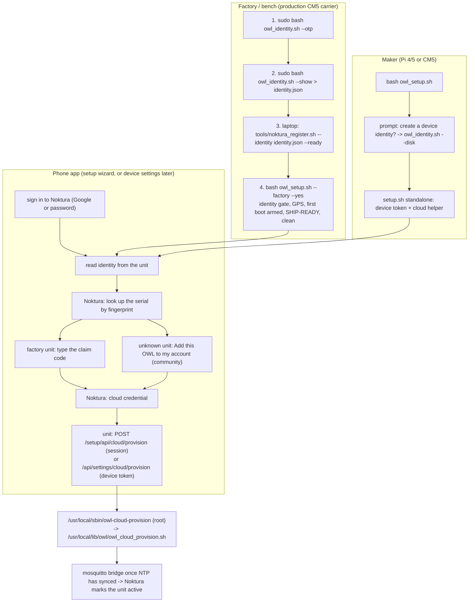

# OWL first-boot setup

Appliance-style first boot: a factory-fresh (or factory-reset) OWL broadcasts
its `OWL-XXXX` hotspot with a fixed setup password, and the OWL phone app
(private `owl-app` repo) walks the user from unboxing to a working unit.

This directory is **not** the standalone controller — it is a small,
self-terminating Flask API (`setup_app.py`, port 8088) that only exists while
the first-boot flag is present.

> **v3.19.0 (2026-09-17):** the ship command is `bash owl_setup.sh --factory`,
> the setup API is served over HTTPS with a setup session, and the phone app can
> claim the unit in Noktura and connect it to the cloud during setup. These
> changes come from the cross-repo review of 2026-09-17 (Noktura session, decisions
> by Guy); finding IDs such as `O-1` refer to `Noktura/docs/owl/OWL_CLAIM_MVP_REVIEW-2026-09-17.md`.
> See "Scripts and lifecycle" below.

## Lifecycle

```
sudo bash install_firstboot.sh --arm          (image prep / factory reset)
        ↓ reboot
owl-firstboot.service starts (ConditionPathExists=/boot/firmware/owl-firstboot.flag)
        ↓
startup(): hotspot down → WiFi scan (cached) → hotspot up
        ↓
phone app joins OWL-XXXX (fixed password "owl-setup"), drives /setup/api/*
        ↓
either  finish(standalone): user sets a permanent hotspot password
or      wifi/join → OWL switches to the customer's network (auto-reverts to
        hotspot if the join fails) → finish(wifi)
        ↓
teardown: flag removed, avahi entry + ufw rule removed, service exits
          and can never restart until re-armed
```

## API

All endpoints are JSON under `/setup/api/`; errors are
`{"success": false, "error": "..."}`. See the `API.md` contract in the
owl-app repo for full request/response shapes.

**Transport (contract 5, O-5):** `https://10.42.0.1:8088` with the dashboard's
self-signed certificate (`/etc/ssl/certs/owl.crt`, written by
`controller/shared/setup.sh`). A dev machine without the certificate falls back
to plain HTTP and logs an error.

**Setup session (contract 5, O-5):** the first phone to `POST /setup/api/session`
gets a token (201; the same phone re-opening gets 200). Every route that changes
the unit (`wifi/join`, `controller/join`, `hotspot/restore`, `finish`,
`cloud/provision`) needs it in `X-Setup-Session`, else `403
setup_session_required`. Another phone gets `409 setup_in_use` until the session
has been idle for 10 minutes or the service restarts. `GET` routes stay open so
the app can identify the unit first.

**Contract versioning:** `info` (and the fleet controller descriptor, and
the standalone dashboard's `system_stats`) carry `contract_version`
(`APP_CONTRACT_VERSION` in `version.py`). The phone app checks it on first
contact and blocks with an update message on a mismatch instead of failing
mysteriously mid-wizard. Bump it ONLY for breaking changes — additive
fields don't bump; old servers without the field are treated as version 1.

| Endpoint | Method | Purpose |
|---|---|---|
| `/setup/api/session` | POST | open or re-open the setup session → `{session}` (201 new, 200 same phone), 409 `setup_in_use` |
| `/setup/api/info` | GET | device id, version, `contract_version`, hotspot, camera check, owl.service state, `identity` (`hw_id`, `tier` otp\|disk\|none, key `fingerprint`, `noktura_serial`), `cloud` (read from `[Cloud]` in `CONTROLLER.ini`, O-18; null until provisioned) and `clock_synced` (NTP state from `timedatectl`) |
| `/setup/api/identity` | GET | identity plus the public key PEM (`public_key`); the app sends it to Noktura when a maker registers a unit Noktura has never seen |
| `/setup/api/camera/frame` | GET | single JPEG (proxy of owl.py :8001) |
| `/setup/api/camera/stream` | GET | MJPEG stream proxy |
| `/setup/api/camera/diagnostics` | GET | sensor-level triage when no frames arrive: `status` is `ok` \| `overlay_missing` (dtoverlay not in config.txt) \| `probe_failed` (kernel saw the sensor but it didn't come up; `-121` in `detail` = I2C NACK) \| `no_rpicam` |
| `/setup/api/wifi/scan` | GET | cached scan; `?rescan=true` cycles the AP (drops clients) |
| `/setup/api/wifi/join` | POST | `{ssid, password?}` (password omitted for open networks) → 202, switch happens 5 s later |
| `/setup/api/wifi/result` | GET | join outcome (persisted across reboots); includes `warning` for non-fatal problems (`owl_restart_failed`, `hotspot_unavailable`) |
| `/setup/api/status` | GET | state machine + network mode (polled pre/post switch) |
| `/setup/api/hotspot/restore` | POST | abandon client attempt, re-raise the AP |
| `/setup/api/controller/join` | POST | join a rig: `{ssid, password, device_id, static_ip, gateway, subnet_prefix, broker_ip, broker_port, dns?}` (identity assigned by the controller's `/api/fleet/reserve`; IPs and int ranges validated) → 202, switch 5 s later |
| `/setup/api/finish` | POST | `{mode: standalone\|wifi\|controller, new_password?}` → teardown |
| `/setup/api/cloud/provision` | POST | session required. The bridge credential the app received from Noktura (`{broker_host, broker_port, device_id, username, password, portal_url, storage_host, replace?}`) → root helper `/usr/local/sbin/owl-cloud-provision`, which runs the root-owned copy `/usr/local/lib/owl/owl_cloud_provision.sh` (O-1; password on stdin, never argv). Can take up to ~120 s (mosquitto install/restart). 400 bad payload, 409 `cloud_site_conflict` when the unit is already on a different Noktura site and `replace` is not true, 500 helper failure with `detail` |

## Controller join (networked rigs)

The join sequence: set hostname (`owl-N`) → rewrite `CONTROLLER.ini`
(`[MQTT] broker_ip/device_id`, `[Network] mode/static_ip` — all other
sections preserved) → join the rig WiFi with the assigned **static IP** →
restart `owl.service` so it heartbeats to the controller (which
auto-confirms the reservation; a failed restart is surfaced as
`warning: owl_restart_failed` rather than silently claiming success). On a
failed radio switch the OWL reverts to its hotspot, but hostname/config are
**deliberately kept** — they describe the target state, the reservation is
still held, and a retry re-runs only the switch. An **abandoned** join is
different: `POST /setup/api/hotspot/restore` rolls the identity back
(pre-join `CONTROLLER.ini` backup + hostname), so a cancelled wizard never
leaves the OWL pointed at a rig it never joined.
Verification polls `https://<static_ip>:8088/setup/api/wifi/result`.

## If the setup service can't start

`owl-firstboot.service` carries `OnFailure=owl-firstboot-fallback.service`:
after 3 failed starts inside 60 s, systemd launches `fallback_server.py`
(system python, stdlib only — the venv may be the broken part) on the same
port. It answers every request with 503 JSON containing the crashed unit's
journal tail, so the phone app surfaces the real error instead of
"Failed to fetch". The fallback is condition-gated on the flag like the
main unit and is removed by `--disarm`.

## Why the scan is cached

The Pi's radio cannot scan while it is an access point. `startup()` scans once
before raising the AP (no phone is connected yet, so nothing drops).
`?rescan=true` knowingly cycles the AP; the app warns the user and reconnects.

## Scripts and lifecycle

Added 2026-09-17 (cross-repo review, O-16 to O-21 and the "one ship path"
decision). Which script does what, who runs it, and where state lives.

| Script | Run by | As | Does |
|---|---|---|---|
| `owl_setup.sh` | person | user (never sudo) | Full install. No option: maker install (interactive). `--factory [--yes]`: the only ship command. |
| `owl_identity.sh` | person | root | Device identity in `/etc/owl-identity/`. `--otp` (CM5/Pi 5 OTP key, permanent, type `GENKEY`), `--disk` (key file, makers), `--show` (JSON), `--serial OWL-…` (optional local label), `--sign FILE` (bench spike). No other script writes identity. |
| `controller/shared/setup.sh` | `owl_setup.sh` (or a person re-running network setup) | root | Hotspot/network, dashboard, nginx certificate, device token, and for every standalone unit the cloud helper. Preserves `[Cloud]` and `[Security]` when it rewrites `CONTROLLER.ini` (O-17). |
| `controller/setup/install_firstboot.sh` | `owl_setup.sh` / `setup.sh` | root | `--arm` / `--disarm` first boot, `--camera-config`, `--gps-config`, `--cloud-helper`. |
| `owl_cloud_provision.sh` | the root helper (phone app), or a person for manual rigs | root | Mosquitto bridge to Noktura, `[Cloud]`, credentials in `~/.owl/cloud`. |
| `owl_update.sh` | dashboard / cloud `update_software` | user (systemd-run) | git + pip update with rollback. Does **not** refresh the root helper copy (O-23): after an update that changes `owl_cloud_provision.sh`, run `sudo bash controller/setup/install_firstboot.sh --cloud-helper`. |
| `tools/noktura_register.sh` | Guy / factory, **laptop only** | laptop user | Registers an identity with Noktura using the factory token; prints the serial, claim code and a claim card. |
| `dev/clean.sh` | `owl_setup.sh --factory` (last step, detached) | root | Strips dev residue before boxing. |



**Where state lives on the unit:**
- Identity: `/etc/owl-identity/` (`device.pub`, `tier`, `device.key` for the disk tier only, optional `noktura_serial`).
- Cloud: `/etc/mosquitto/conf.d/owl-cloud.conf`, `[Cloud]` in `config/CONTROLLER.ini`, `~/.owl/cloud/`.
- Setup armed: `/boot/firmware/owl-firstboot.flag`.
- Root helpers: `/usr/local/sbin/owl-firstboot-arm`, `/usr/local/sbin/owl-cloud-provision`; the provision script they run: `/usr/local/lib/owl/` (root-owned, so the OWL user cannot edit what root runs, O-1).

**Where the serial comes from.** Noktura issues it when the unit is registered.
Nothing needs typing back onto the unit: the phone app reads the key fingerprint
and asks Noktura for the serial. `owl_identity.sh --serial` only writes a local
label; if it disagrees with Noktura, Noktura wins and the app says so. With no
signal at setup the farmer skips the claim and does it later from device
settings (signing in needs internet anyway).

**Makers (DIY).** Answer `y` to the identity prompt in `bash owl_setup.sh`. In the
app, sign in and choose "Add this OWL to my account": Noktura registers the unit
as a community device owned by you (no claim code), then the same cloud step
runs. A maker unit that skipped the prompt can run `sudo bash owl_identity.sh --disk`
later.

**Clock.** The Pi has no RTC. The bridge needs a correct clock for TLS, so the
dashboard and the setup API report `clock_synced` and the app shows "Waiting for
the clock" until NTP syncs. The unit does not fake the time (no `fake-hwclock`;
decided 2026-09-17).

## Shipping / demo-image prep

One command, on a unit that already has its identity and is registered
(steps 1 to 3 above):

```
bash owl_setup.sh --factory
```

Non-interactive: base install, standalone setup with hotspot `OWL-XXXX`
(suffix from the Pi serial) and the fixed setup password, nRF9151 GPS, then
arms first-boot. `--ship` and `--ship-gps` were removed in v3.19.0 with no
aliases.

**Identity gate.** Before anything is installed it checks
`/etc/owl-identity/device.pub` exists and `tier` is `otp`; otherwise it prints
`[NOT SHIP-READY] No hardware identity` and stops. SHIP-READY prints the
identity tier and fingerprint prefix so you can match it to the claim card.

It first asks you to type `FACTORY`, because it deletes WiFi profiles and SSH
keys and keeps detection off until phone setup finishes. For factory
automation pass `--yes` as the second argument (`bash owl_setup.sh --factory
--yes`). Never run it with sudo, and never on a development machine. It needs
passwordless sudo and re-runs itself detached, logging to `~/owl_setup.log`.
Building your own OWL? Run `bash owl_setup.sh` with no options.

**Production carrier GPS:** `--factory` also provisions the nRF9151 modem (Serial LTE Modem firmware):
`dialout` for the OWL user, ModemManager off, `install_firstboot.sh
--gps-config` (writes `dtoverlay=uart3-pi5` and `gpio=26=op,dh` to config.txt
and applies both immediately), `[GPS] source = nrf91`, `port = /dev/ttyAMA3`,
`baudrate = 460800` in `config/CONTROLLER.ini`, then an `AT` link check. A
failed config write or no `AT` reply is NOT SHIP-READY (reboot and re-run; re-runs
are safe). The OWL starts GPS over AT commands on every connect. For bench
diagnosis run `bash tools/nrf9151_probe.sh` (power-cycles the modem, checks
`AT`, tries for a fix, prints a verdict).

**CM5 camera:** Compute Modules have **no camera autodetection** — the stock
`camera_auto_detect=1` silently does nothing, so a fresh flash never loads
the sensor overlay (no error, no I2C bus, no camera). Both `owl_setup.sh`
(before its camera checks) and `install_firstboot.sh --arm` write the fix to
`/boot/firmware/config.txt` under `[all]`: `camera_auto_detect=0`,
`dtoverlay=imx296` on **both** CSI ports (same sensor on both is safe; two
*different* sensors collide at I2C 0x1a), and the `i2c_csi_dsi` dtparams so
`i2cdetect` works in the field. Idempotent; skipped with a warning on
non-CM boards (Pi 4/5 autodetect works and must not be fought). Standalone
entry: `sudo bash install_firstboot.sh --camera-config` (exit 2 = changed,
reboot needed). The sensor name is `CAMERA_OVERLAY` at the top of
`install_firstboot.sh` — a sensor swap must also update `CAMERA_SENSOR` in
`firstboot_state.py` (a unit test cross-checks them). Rule of thumb: after
any re-flash, verify config.txt state before debugging hardware. As its final step it runs `dev/clean.sh --yes` detached, which
strips dev residue — **every WiFi profile except the OWL hotspot** (a dev
phone-hotspot password must never ship on a unit), shell history, SSH keys,
logs, cached credentials. If you are SSH'd in over a personal network the
session drops at that point by design; give it a minute
(`/var/log/owl-ship-clean.txt`), then focus the camera, power off, box it.

Manual route (existing installs): run `controller/shared/setup.sh` in
**standalone** mode (keep the `OWL-` SSID prefix — the phone app's
auto-connect matches `OWL-*` only) and answer yes to its arm prompt, or run
`sudo bash controller/setup/install_firstboot.sh --arm` yourself. Arming
refuses if no hotspot profile exists — that ordering is what guarantees a
phone can always reach an armed unit.

Bench verification: work through `BENCH_TEST.md` in this directory.

## Factory reset / re-entering setup

- From the standalone dashboard: Config tab → "Reset network setup", then reboot.
- Over SSH: `sudo bash controller/setup/install_firstboot.sh --arm && sudo reboot`
- From any PC with the SD card: create an empty file `owl-firstboot.flag` on
  the boot (FAT) partition — arming survives because the systemd unit stays
  installed after finish; only the flag is consumed.

## During first boot

`owl.py` still runs (it feeds the camera preview) but detection is **locked
off for as long as the flag exists** — the state thread re-asserts it, so a
flipped-on hardware detection switch or a dashboard toggle cannot click
relays on the bench. Normal control returns within seconds of setup
finishing (the flag is re-checked at a slow cadence off the hot path; when
the flag was absent at boot, nothing is ever checked).

## Security posture (deliberate, revisit before mass rollout)

Since v3.19.0 (O-5): the setup API is HTTPS and one phone holds the setup
session, so a second phone in radio range cannot join Wi-Fi, finish setup or
overwrite the cloud credential. `cloud/provision` also refuses to move a unit to
a different Noktura site without `replace: true`.

Still open: the hotspot PSK is fixed and public (`owl-setup`) and the app accepts
the self-signed certificate for private hosts, so an active man-in-the-middle on
the hotspot during first boot can still intercept. Closed by certificate pinning
in the full trust chain (OWL-DES-014). Deferred hardening (log only, not needed
for the prototype): O-12 (identity script edge cases), O-13 (register script
temp file and token in `ps`), O-22 (root copy writes into user-owned paths).
Reset-setup on the dashboard is token-guarded (O-19).

## Tests

`pytest tests/test_setup_app_routes.py tests/test_network_manager.py
tests/integration/test_firstboot_integration.py -v` — the first two are
unit-level (mocked nmcli, manual timers); the integration suite runs the
real Flask app over a real socket with real timer handoffs against a
stateful fake nmcli. All platform-independent.
